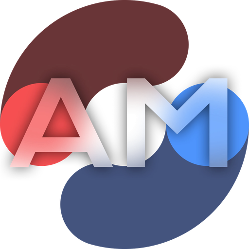

<p align="center">
  <a href="https://adomods.org"></a>
</p>

<h1 align="center">ADOMODS</h1>

<p align="center">
  얼불춤(A Dance of Fire and Ice) 모드를 한눈에 찾아보고 바로 내려받는 사이트<br />
  <b><a href="https://adomods.org">adomods.org</a></b>
</p>

---

## 소개

ADOMODS는 [ADOFAI.gg](https://adofai.gg) 디스코드에 올라온 얼불춤 모드를 모아 보여주는 비공식 사이트입니다. 모드 데이터는 [bot.adofai.gg](https://bot.adofai.gg/api/mods/)에서 가져옵니다.

- **검색과 필터:** 이름·설명·개발자로 검색할 수 있습니다(초성 검색 지원). 최신순·이름순으로 정렬하고, 최근 7일·개발자·즐겨찾기로 거를 수 있습니다.
- **모드 상세:** 디스코드 서식을 그대로 살린 설명을 보여줍니다. 이미지·동영상·파일 링크는 미리보기로 표시합니다.
- **버전 기록:** 예전 버전의 설명을 보고 그 버전을 내려받을 수 있습니다.
- **바로 다운로드:** GitHub 릴리스, Google Drive, Dropbox, MediaFire 링크에서 파일을 찾아 바로 내려받습니다.
- **개발자 페이지:** 개발자별로 올린 모드를 모아 봅니다.
- **설명 자동 번역:** 다른 언어로 쓰인 설명을 Claude로 번역해 봅니다.
- **5개 언어:** 한국어, English, 简体中文, 日本語, Français를 지원합니다.
- **전체 모드 목록:** [/mods](https://adomods.org/mods)에서 모든 모드를 이름순으로 봅니다.

이전 버전 사이트는 [legacy.adomods.org](https://legacy.adomods.org)에 있습니다(`legacy` 브랜치).

## 개발

[Next.js](https://nextjs.org) (App Router), React, TypeScript, Tailwind CSS, [shadcn/ui](https://ui.shadcn.com)로 만들었고 [Vercel](https://vercel.com)에 배포합니다.

```bash
pnpm install
pnpm dev      # http://localhost:3000
pnpm build    # 프로덕션 빌드
```

### 환경 변수

모두 선택 사항입니다. 없으면 해당 기능만 꺼집니다.

| 이름 | 용도 |
| --- | --- |
| `SITE_URL` | 대표 주소(예: `https://adomods.org`). canonical URL, 사이트맵, 번역 API 허용 도메인에 쓰입니다. |
| `MODS_API_URL` | 모드 API 주소. 기본값은 `https://bot.adofai.gg/api/mods/`입니다(로컬 테스트용 목 서버를 가리킬 때 사용). |
| `DISCORD_BOT_TOKEN` | 만료된 디스코드 첨부파일 링크(이미지·파일)를 다시 서명합니다. |
| `GITHUB_TOKEN` | GitHub 릴리스 조회 한도를 늘립니다. |
| `ANTHROPIC_API_KEY` | 설명 자동 번역(Claude)을 켭니다. 설정 후 다시 빌드해야 번역 버튼이 나타납니다. |
| `GOOGLE_SITE_VERIFICATION` · `NAVER_SITE_VERIFICATION` · `BING_SITE_VERIFICATION` | 검색엔진 소유 확인용 메타 태그입니다. |

## 문의

사이트 오류 제보나 모드 정보 수정 요청은 디스코드 **@maijeun**으로 연락해 주세요.

---

ADOMODS는 7th Beat Games 또는 ADOFAI.gg에서 제작되거나 승인받지 않았습니다.<br />
ADOMODS is not created nor approved by 7th Beat Games or the ADOFAI.gg.
